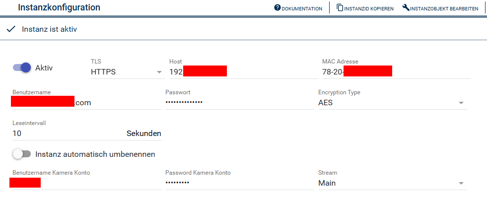

[](https://www.symcon.de/service/dokumentation/entwicklerbereich/sdk-tools/sdk-php/)
[](https://community.symcon.de/t/modul-tp-link-tapo-smarthome/131865)
[](https://www.symcon.de/de/service/dokumentation/installation/migrationen/v81-v90-q1-2026/)  
[](#10-lizenz)
[](https://github.com/Nall-chan/tapo-SmartHome/actions)
[](https://github.com/Nall-chan/tapo-SmartHome/actions)  
[](#2-spenden)
[](#2-spenden)  

# tapo Camera <!-- omit in toc -->

Einbindung von TP-Link Tapo Überwachungskameras

## Inhaltsverzeichnis <!-- omit in toc -->

- [1. Funktionsumfang](#1-funktionsumfang)
- [2. Voraussetzungen](#2-voraussetzungen)
- [3. Software-Installation](#3-software-installation)
- [4. Einrichten der Instanzen in IP-Symcon](#4-einrichten-der-instanzen-in-ip-symcon)
- [5. Statusvariablen](#5-statusvariablen)
- [6. Visualisierung](#6-visualisierung)
  - [Kachel Visualisierung](#kachel-visualisierung)
  - [WebFront Visualisierung](#webfront-visualisierung)
- [7. PHP-Befehlsreferenz](#7-php-befehlsreferenz)
- [8. Aktionen](#8-aktionen)
- [9. Anhang](#9-anhang)
  - [1. Changelog](#1-changelog)
  - [2. Spenden](#2-spenden)
- [10. Lizenz](#10-lizenz)

## 1. Funktionsumfang

- Lokale Netzwerkkommunikation mit Tapo Kameras
- Abruf von Geräteinformationen

**Hinweis**: Die Kameras müssen in der TP-Link/Tapo Cloud registriert sein, damit die lokale Anmeldung funktioniert!

## 2. Voraussetzungen

- IP-Symcon ab Version 9.0  
- Tapo Kamera mit lokalen Kamerazugangsdaten konfiguriert  

## 3. Software-Installation

- Dieses Modul ist Bestandteil der [tapo SmartHome-Library](../README.md#3-software-installation).  

## 4. Einrichten der Instanzen in IP-Symcon

Bei der manuellen Einrichtung ist das Modul im Dialog `Instanz hinzufügen` unter den Hersteller `TP-Link` zu finden.  
  

Damit Symcon mit den Geräten kommunizieren können, müssen diese in der TP-Link Cloud angemeldet und registriert sein.  

Die entsprechenden Cloud-Zugangsdaten, die MAC-Adresse und das genutzte Protokoll werden beim anlegen durch die [Discovery-Instanz](../Tapo%20Discovery/README.md) automatisch eingetragen.

### Konfigurationsseite <!-- omit in toc -->

  

**Benutzername und Passwort sind die Cloud/App Zugangsdaten!**  
**Benutzername und Passwort für das Kamera Konto sind in der App einzurichten!**  

| Eigenschaft                    | Name        | Typ     | Standardwert | Beschreibung |
| ------------------------------ | ----------- | ------- | ------------ | ------------ |
| Aktiv | Open | boolean | false | Verbindung zum Gerät herstellen |
| TLS | Protocol | string | `http://` | `http://` oder `https://` (die Discovery-Instanz trägt den passenden Wert ein) |
| Host | Host | string | leer | IP-Adresse oder Name des Gerätes |
| MAC Adresse | Mac | string | leer | MAC Adresse des Gerätes (wird von der Discovery-Instanz zur Zuordnung benötigt) |
| Benutzername | Username | string | leer | Benutzername für die Anmeldung (TP-Cloud Benutzername: eMail-Adresse) |
| Passwort | Password | string | leer | Passwort für die Anmeldung (TP-Cloud Passwort) |
| Verschlüsselungstyp | EncryptType | string | `KLAP` | `KLAP` oder `AES`, wird von der Discovery-Instanz passend zum Gerät eingetragen |
| Leseintervall | Interval | integer | 5 | Intervall der Abfrage von Status und Werten in Sekunden, `0` deaktiviert die zyklische Abfrage |
| Instanz automatisch umbenennen | AutoRename | boolean | false | Instanz erhält den Namen, welcher in der App vergeben wurde |
| Benutzername Kamera Konto | UsernameCamera | string | leer | Benutzername vom Kamerakonto, welches in der App vergeben wurde |
| Passwort Kamera Konto | PasswordCamera | string | leer | Passwort vom Kamerakonto, welches in der App vergeben wurde |
| Stream | Stream | string | `stream1` | `stream1` oder `stream2`: Auswahl des Videostreams |

Beispiel:  

```php
IPS_SetProperty(12345, 'Host', '192.168.0.10');
IPS_SetProperty(12345, 'Open', true);
IPS_ApplyChanges(12345);
```

**Instanz automatisch umbenennen (`AutoRename`):** Die Funktion ist standardmäßig ausgeschaltet. Ist sie aktiv, erhält die Instanz bei der Abfrage des Gerätes den Namen, der in der tapo-App vergeben wurde, sofern er sich vom Namen der Instanz unterscheidet. Ein selbst vergebener Instanzname wird dabei überschrieben, Statusvariablen werden nicht umbenannt.  

## 5. Statusvariablen

Die Statusvariablen werden automatisch angelegt. Das Löschen einzelner kann zu Fehlfunktionen führen.

## 6. Visualisierung

### Kachel Visualisierung

Die Statusvariablen der Instanz werden in der Kachel-Visualisierung als Liste dargestellt. Bedienbare Variablen können direkt in der Kachel geschaltet werden.  

### WebFront Visualisierung

Die Statusvariablen können im klassischen WebFront wie jede andere Variable angezeigt und bedient werden.  
Teilweise werden Font-Awesome-Symbole verwendet, diese zeigt das klassische WebFront nicht an.  

## 7. PHP-Befehlsreferenz

```php
bool TAPOSH_RequestState(integer $InstanzID);
```

Fragt den Zustand des Gerätes ab und aktualisiert die Statusvariablen. Das geschieht auch zyklisch im eingestellten Leseintervall.  

| Parameter | Beschreibung |
| --------- | ------------ |
| `$InstanzID` | Objekt-ID der tapo-Instanz |

Rückgabewert: `true`, wenn das Gerät geantwortet hat und die Variablen aktualisiert wurden, sonst `false` (mit Fehlermeldung).  

Beispiel:  

```php
TAPOSH_RequestState(12345);
```

---

```php
array|false TAPOSH_GetDeviceInfo(integer $InstanzID);
```

Liefert die rohen Geräteinformationen (`get_device_info`) des Gerätes als Array. Die Werte werden nicht in Statusvariablen übernommen.  

| Parameter | Beschreibung |
| --------- | ------------ |
| `$InstanzID` | Objekt-ID der tapo-Instanz |

Rückgabewert: Array mit den Geräteinformationen, bei einem Fehler `false`.  

Beispiel:  

```php
$Info = TAPOSH_GetDeviceInfo(12345);
print_r($Info);
```

## 8. Aktionen

**Grundsätzlich können alle bedienbaren Statusvariablen als Ziel einer [`Aktion`](https://www.symcon.de/service/dokumentation/konzepte/automationen/ablaufplaene/aktionen/) mit `Auf Wert schalten` angesteuert werden, so dass hier keine speziellen Aktionen benutzt werden müssen.**

Es gibt keine speziellen Aktionen für dieses Modul.  

## 9. Anhang

### 1. Changelog

[Changelog der Library](../README.md#2-changelog)

### 2. Spenden

  Schenkungen als Unterstützung für den Autor werden hier akzeptiert:  

[](https://paypal.me/Nall4chan)  

[](https://www.amazon.de/hz/wishlist/ls/YU4AI9AQT9F?ref_=wl_share)  

## 10. Lizenz

  IPS-Modul:  
  [Custom NC-SA](../LICENSE)  
  